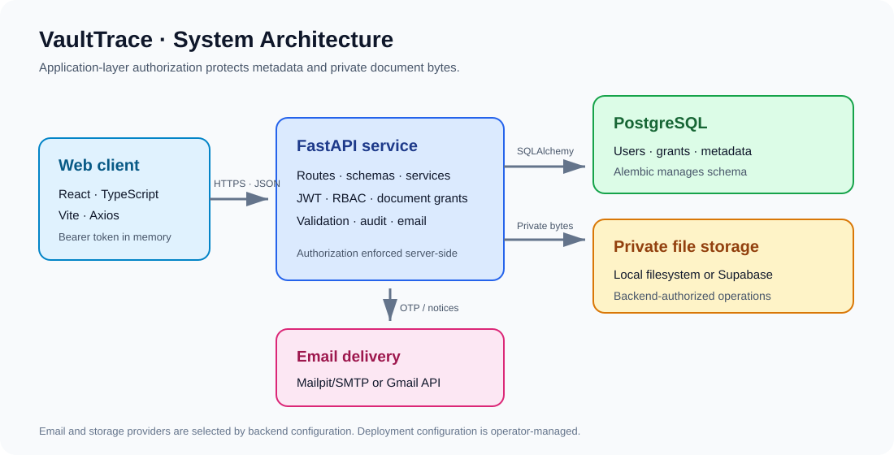
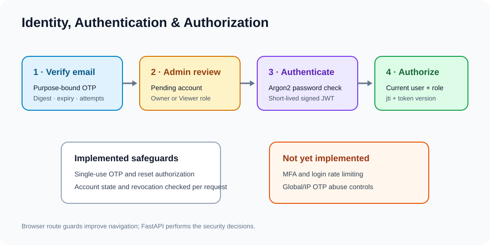
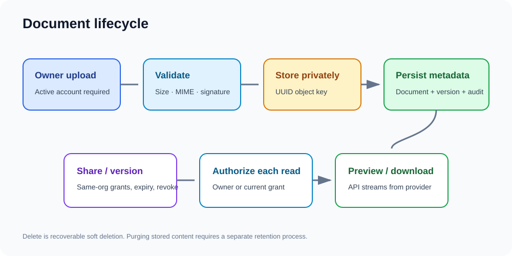
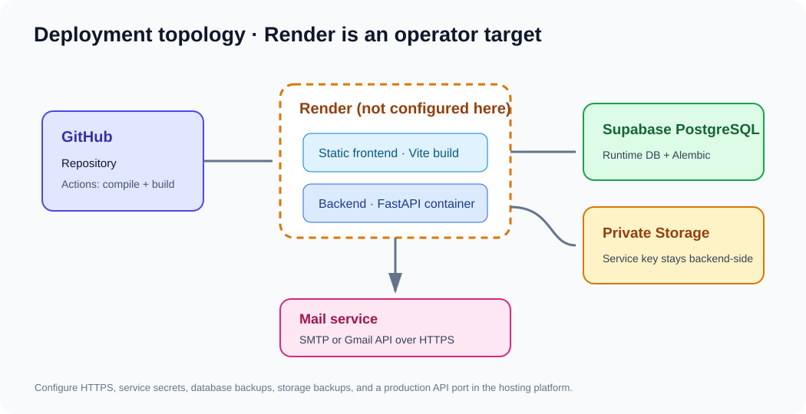
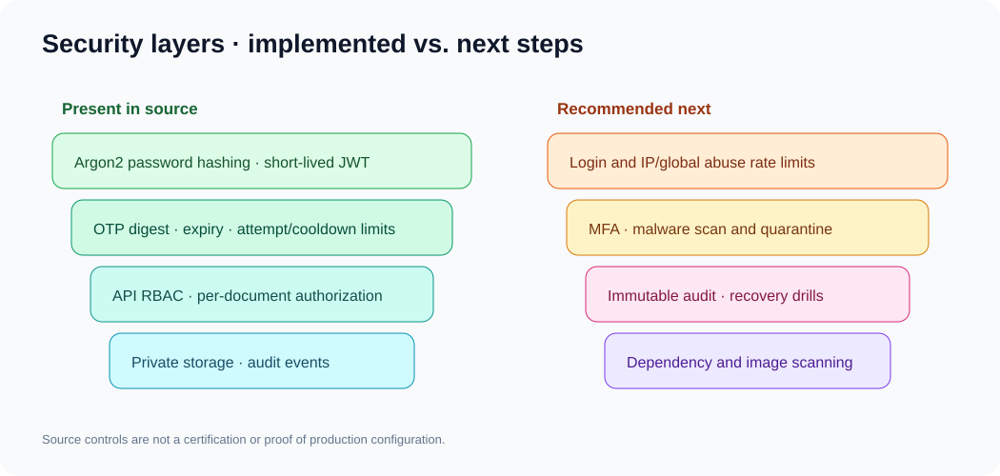

# VaultTrace

VaultTrace is a document management application built with React, FastAPI, and PostgreSQL. It provides verified account registration with administrator approval, role-aware administration, private file storage, explicit document sharing, version history, and audit records.

> **Project status:** This repository contains the application and local development setup. It does not contain a Render deployment manifest, a production frontend image, or evidence of production security certification. Review [known limitations](docs/ROADMAP.md#known-limitations) and [deployment guidance](docs/DEPLOYMENT.md) before deploying.

## Contents

- [Features](#features)
- [Technology](#technology)
- [Architecture](#architecture)
- [Authentication and documents](#authentication-and-documents)
- [Quick start](#quick-start)
- [Environment variables](#environment-variables)
- [Database and migrations](#database-and-migrations)
- [Docker Compose](#docker-compose)
- [Tests](#tests)
- [API documentation](#api-documentation)
- [Known limitations and roadmap](#known-limitations-and-roadmap)
- [Troubleshooting](#troubleshooting)
- [Contributing](#contributing)
- [Security](#security)
- [Documentation](#documentation)
- [License](#license)

## Features

- Email OTP verification and administrator-reviewed registration.
- Administrator, Owner, and Viewer roles enforced by the API.
- Argon2 password hashing, short-lived JWT access tokens, logout revocation, and password reset.
- Private local-storage and Supabase Storage adapters.
- Server-validated document uploads, authorized previews/downloads, versions, soft deletion, and restore.
- Explicit READ/EDIT sharing for active, verified members of the same organization, with expiry and revocation.
- Administrator user, application, organization, document-metadata, and audit pages.
- Mailpit/SMTP locally and optional Gmail API email delivery.

The backend rechecks document access for each operation. Administrators can inspect metadata and revoke grants; the administrative document APIs do not provide a general file-content bypass.

## Technology

| Component | Technology |
|---|---|
| Web client | React 18, TypeScript, Vite, React Router, Axios |
| API | Python 3.12, FastAPI, Pydantic 2 |
| Database | PostgreSQL, SQLAlchemy 2, Psycopg 3 |
| Migrations | Alembic |
| Password/JWT | `pwdlib` Argon2, `python-jose` JWT |
| Storage | Private local filesystem or Supabase Storage REST API |
| Email | SMTP/Mailpit or optional Gmail API |
| Automation | Docker Compose, GitHub Actions, pytest, Playwright scaffold |

## Architecture



### Visual overviews

These explanatory illustrations are based on source code and deployment files; they are not screenshots of a running product.

| Overview | Illustration |
|---|---|
| Authentication and security |  |
| Document lifecycle |  |
| Deployment target |  |
| Enterprise security layers |  |

The browser calls the FastAPI JSON API with bearer tokens. API routes delegate business rules to services, SQLAlchemy persists identity and document metadata in PostgreSQL, and authorized storage operations access the configured private file provider. See [Architecture](docs/ARCHITECTURE.md) for the Mermaid system, auth, document, sharing, email, and security diagrams and [Database](docs/DATABASE.md) for the ER diagram.

### Authentication and documents

Applicants verify an email OTP, submit a registration application, and wait for an Administrator to assign the Owner or Viewer role. Login returns a short-lived JWT; protected API requests check its signature, expiry, revocation state, account state, and token version. See [Authentication flow](docs/ARCHITECTURE.md#authentication-lifecycle).

Owners upload validated documents. PostgreSQL stores metadata and object references; private storage holds the bytes. Owners can create versions, soft-delete and restore documents, and grant same-organization users time-limited READ/EDIT access. The backend checks current grants for each read or edit. See [Document lifecycle](docs/ARCHITECTURE.md#document-upload-and-download), [sharing flow](docs/ARCHITECTURE.md#sharing-and-authorization), and [database relationships](docs/DATABASE.md#entity-relationship-diagram).

## Quick start

### Requirements

- Python 3.12 and PostgreSQL reachable from the backend.
- Node.js 20 or newer and npm.
- Optional: Docker Engine and Compose for Mailpit and the application containers.

### Configure local environment

Copy the example only when a root `.env` does not already exist. Edit the new file with local values; do not overwrite an existing environment file.

```bash
test -f .env || cp .env.example .env
```

Set at least `DATABASE_URL` and a strong random `JWT_SECRET_KEY`. For local storage, `STORAGE_PROVIDER=local` is the default outside production. `.env.example` documents the other settings and their defaults. Never put secrets in `VITE_*` variables.

## Environment variables

The full variable list and non-secret examples are in [`.env.example`](.env.example). Backend-only secrets include database/JWT/OTP, SMTP or Gmail OAuth, Supabase service-role, and bootstrap credentials. `VITE_*` variables are embedded into browser assets and must contain public configuration only. See [Deployment](docs/DEPLOYMENT.md#render-deployment-shape) for the production frontend/backend split.

### Start the backend

From the repository root:

```bash
python3.12 -m venv .venv
source .venv/bin/activate
python -m pip install -r requirements.txt
alembic -c backend/alembic.ini upgrade head
uvicorn app.main:app --reload --app-dir backend
```

The database must already exist and be reachable through `DATABASE_URL`. Alembic applies schema migrations; it does not copy local user or document records to another database. If the virtual environment is named differently, activate that environment instead.

### Start the frontend

In another terminal:

```bash
cd frontend
npm ci
npm run dev -- --host 127.0.0.1
```

The default local API base URL is `http://localhost:8000/api/v1`. Set `VITE_API_BASE_URL` before starting Vite if the API uses a different local URL.

### Windows PowerShell note

From the repository root, create and activate the environment with `py -3.12 -m venv .venv` and `.\.venv\Scripts\Activate.ps1`, then install with `python -m pip install -r requirements.txt`. Start the backend with `$env:PYTHONPATH='backend'; uvicorn app.main:app --reload --app-dir backend`. In another terminal, use `cd frontend; npm ci; npm run dev`. Docker Compose uses `network_mode: host` for the backend and is intended for Linux; it is not a portable Windows/macOS network setup.

## Database and migrations

There are ten sequential migrations, from `20261103_0001` to `20261105_0010`. Inspect the current revision and local head with:

```bash
alembic -c backend/alembic.ini current
alembic -c backend/alembic.ini heads
```

Apply migrations only after confirming the target URL and reviewing the migration plan:

```bash
alembic -c backend/alembic.ini upgrade head
```

Alembic uses `DATABASE_URL` by default. Production selection is an explicit setting: set `ALEMBIC_USE_PRODUCTION_DATABASE=true` and `PRODUCTION_DATABASE_URL` in the migration process environment. Keep runtime and migration credentials controlled by the deployment operator. Do not paste connection URLs into shell transcripts or documentation. See [Database](docs/DATABASE.md) and [Deployment](docs/DEPLOYMENT.md).

## Docker Compose

The Compose file starts Mailpit, the backend, and the Vite development server. It does **not** start PostgreSQL; configure an existing database first.

```bash
docker compose up --build
```

Local endpoints are typically:

- Frontend: `http://localhost:5173`
- API: `http://localhost:8000`
- FastAPI OpenAPI UI: `http://localhost:8000/docs`
- Mailpit inbox: `http://localhost:8025`

The Compose backend uses host networking, so the `SMTP_HOST` and database host must be reachable from the host network. Stop with `Ctrl-C`, then use `docker compose down`. Compose does not run Alembic automatically.

## Tests

Run the backend test suite from the repository root after configuring the test environment:

```bash
PYTHONPATH=backend python -m pytest backend/tests -q
```

The backend test harness uses an in-memory SQLite database (`backend/tests/database.py`); it does not migrate or copy local/production PostgreSQL data. Browser tests use Playwright and a local Vite server:

```bash
cd frontend
npm ci
npx playwright install chromium
npm run test:e2e
```

Current GitHub Actions runs Python bytecode compilation and a frontend build. It does not run pytest or Playwright. See [Contributing](docs/CONTRIBUTING.md) for the recommended checks.

## API documentation

When the backend is running, FastAPI serves OpenAPI documentation at `/docs` and the schema at `/openapi.json`. The endpoint reference and real request examples are in [API Guide](docs/API_GUIDE.md). Production operators should decide whether interactive API documentation should be publicly reachable.

## Known limitations and roadmap

The repository does not configure Render, run a production frontend image, or define backups/restore automation. Login throttling, MFA, malware scanning, durable email queues, scheduled retention, and immutable external audit storage are not implemented. The prioritized improvement sequence is in [Roadmap](docs/ROADMAP.md).

## Troubleshooting

- **API cannot connect:** check that PostgreSQL is running/reachable and that `DATABASE_URL` uses the Psycopg 3 SQLAlchemy URL format shown in `.env.example`.
- **Missing table or column:** compare Alembic `current` and `heads`; review migrations before running `upgrade head` against a shared or production database.
- **Browser reports no API response/CORS:** set `VITE_API_BASE_URL` to the API base and `FRONTEND_ORIGIN` to the exact browser origin, then restart/rebuild the respective service.
- **Signup email is not delivered:** check backend email provider selection and provider settings. Local Mailpit captures mail at `http://localhost:8025`; it does not forward mail externally.
- **Production document storage errors:** verify `APP_ENV=production`, `STORAGE_PROVIDER=supabase`, the configured private bucket, and backend-only Supabase settings. The local storage provider is rejected in production mode.
- **A Render service does not start:** check that the service binds to the configured port and `0.0.0.0`; current backend Docker command uses port 8000. See [Deployment](docs/DEPLOYMENT.md).

## Contributing

Contributions should include appropriate tests and documentation, preserve server-side authorization, and exclude credentials and production data. See [Contributing](docs/CONTRIBUTING.md) for local checks and pull-request guidance.

## Project structure

```text
backend/app/api/           FastAPI dependencies and v1 routes
backend/app/core/          Settings and password/JWT security helpers
backend/app/models/        SQLAlchemy entities
backend/app/schemas/       Pydantic request/response models
backend/app/services/      Auth, OTP, admin, audit, document and storage logic
backend/alembic/           Alembic configuration and migration history
backend/tests/             Pytest API, service and security tests
backend/scripts/           Local Gmail OAuth/test utilities
frontend/src/pages/        User and administrator screens
frontend/src/components/   Reusable forms, dialogs and layouts
frontend/src/services/     Frontend API client
frontend/e2e/              Playwright browser-test scaffold
docs/                      Architecture, security, API, database and ops guides
docker-compose.yml         Local Mailpit/API/Vite development services
```

## Security

Security controls and their limits are described in [Security](docs/SECURITY.md). Do not commit `.env`, `credentials.json`, `.gmail_token.json`, storage contents, access tokens, refresh tokens, or production URLs. Report suspected vulnerabilities privately to the project maintainers.

## Documentation

- [Architecture and workflows](docs/ARCHITECTURE.md)
- [Security controls and hardening](docs/SECURITY.md)
- [API reference and examples](docs/API_GUIDE.md)
- [Deployment guide](docs/DEPLOYMENT.md)
- [Database schema and migrations](docs/DATABASE.md)
- [Known limitations and roadmap](docs/ROADMAP.md)
- [Contribution guide](docs/CONTRIBUTING.md)

## License

See [LICENSE](LICENSE) for the license terms.

## Safe enhancement updates

- New account and reset passwords must be at least 12 characters and include an uppercase letter, a lowercase letter, a number, and a special character. The backend enforces the rule for signup, password reset, and both administrator bootstrap scripts; the frontend shows the same requirements and a live strength indicator.
- Password fields are hidden by default and include keyboard-accessible show/hide controls. Login continues to accept existing passwords under the current creation policy so existing accounts are not locked out.
- Upload progress is exposed accessibly to assistive technology. Invalid files are identified individually while other valid queued files can continue, and already uploaded files are not resent on a later retry.
- Profile editing and change-password screens are not available because the project has no existing profile-update or authenticated password-change API. No simulated UI is provided.

Run the focused password-policy and bootstrap regression checks with:

```bash
PYTHONPATH=backend python -m pytest -q backend/tests/test_security.py
PYTHONPATH=backend python -m pytest -q backend/tests/test_auth_api.py -k admin_bootstrap
```

Run the frontend type check and production build with `cd frontend && npm run build`. The browser checks are in `frontend/e2e`; run them with `cd frontend && npm run test:e2e` in a supported Node.js environment.

For this enhancement stage, both focused commands and `npm run build` passed. The full backend suite did not complete in this environment; see the validation record in [PROMPTS.md](PROMPTS.md#vaulttrace-safe-enhancement-and-implementation).

## Dashboard and account management

- Owner and Viewer dashboards show document totals, active sharing counts, storage used, uploads over six months, file types, recent documents, recent document activity, and active documents shared by the account. These values are derived from the existing document, permission, and activity APIs. No storage quota is configured, so the UI reports storage used without presenting an invented utilization percentage.
- The Administrator overview includes existing account and application totals plus active document and permission counts, recent audit activity, and links to existing administration pages.
- Users can edit their own full name, username, and phone number in the dashboard profile panel. Email, role, account status, and organization remain read-only. Username uniqueness is enforced by the existing database constraint and reported as a conflict.
- Authenticated password change verifies the current Argon2 password, enforces the shared password policy for the new password, records an audit event, and invalidates existing access tokens. The user is signed out after the change.
- Charts use accessible SVG rendered by the frontend; no chart dependency was added. Favorites, profile pictures, invitation queues, notifications, and storage quotas are not available because the current data model does not provide those capabilities.

## Dashboard separation and administrator storage

- The user Dashboard is a document workspace with upload trends, file types, current storage usage, sharing counts, recently uploaded/accessed documents, and recent activity. Personal details and password controls live on the separate `/profile` page.
- The administrator Overview includes user registration and active/inactive trends, document counts and types, sharing activity, organization and top-user storage charts, and a period filter (7, 30, 90 days, or all time).
- Administrators can open **Storage management** to search and filter a paginated customer report, sort by storage or document count, and inspect a user’s document sizes, retained versions, largest file, last upload, and recent upload activity. User Management links directly to each customer’s storage detail.
- Admin storage analytics aggregate database metadata from document records and retained versions in SQL. Soft-deleted documents remain included because the application retains their file bytes. These byte totals are not independently verified against object-store billing or object availability.
- No quota is configured, and the schema has no storage snapshots. Remaining quota and historical storage-growth charts are therefore shown as unavailable instead of inferred.
