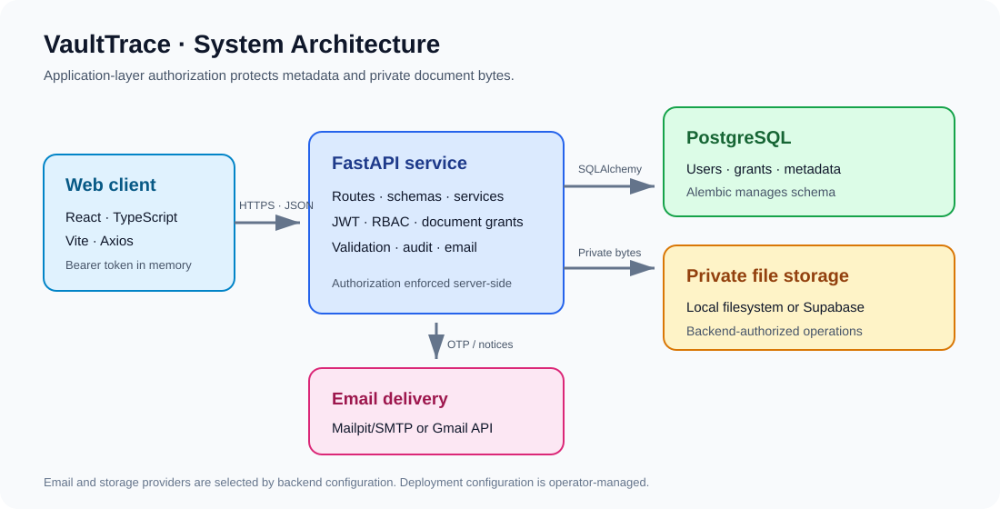
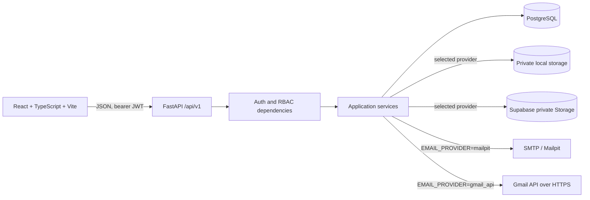
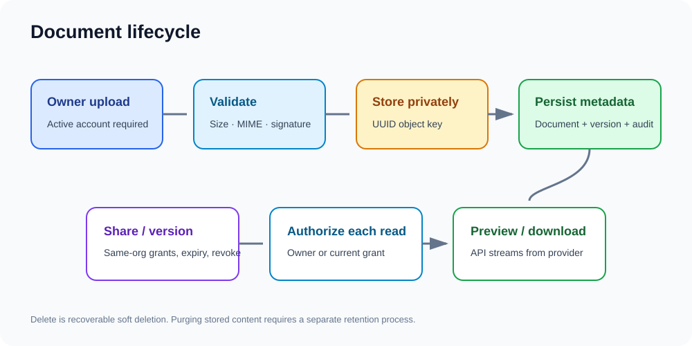
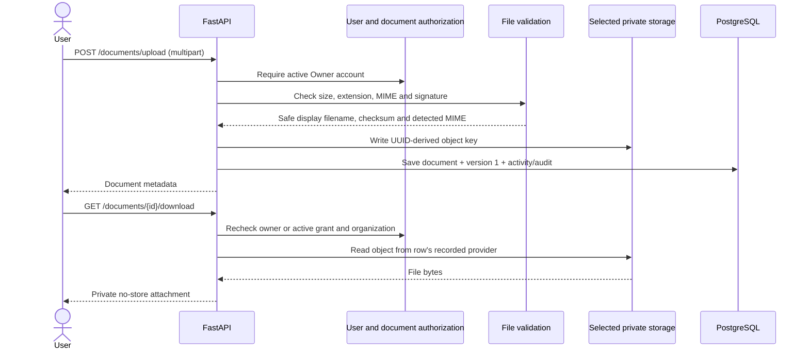
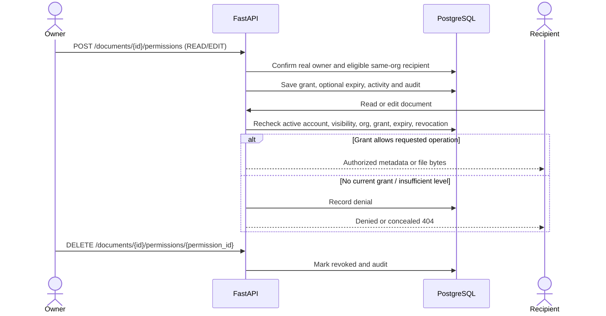
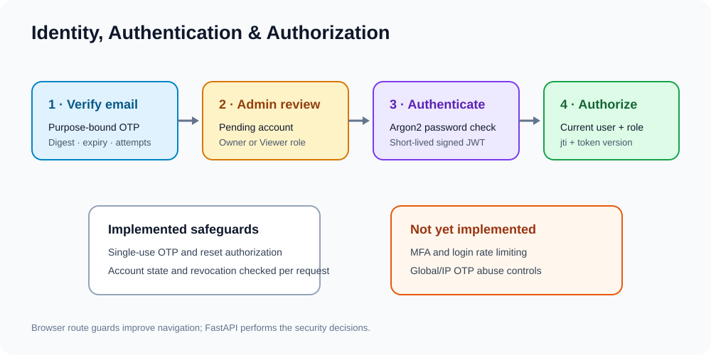
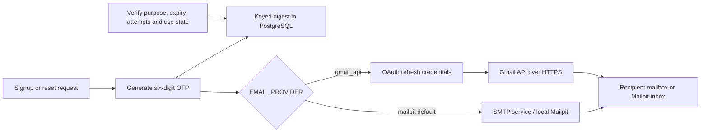

# Architecture and workflows

This document describes behavior verified in the repository. It does not imply a particular live Render or Supabase configuration; those settings are supplied outside the source tree.

## System architecture





The React client uses Axios functions in `frontend/src/services/api.ts`. The backend is layered into route aggregation, dependencies, Pydantic schemas, service functions, SQLAlchemy models, and database sessions. File bytes are outside PostgreSQL; the database stores provider, bucket, key, owner, metadata, and versions.

## Authentication lifecycle

```mermaid
sequenceDiagram
  actor Applicant
  participant UI as React client
  participant API as FastAPI
  participant OTP as OTP service
  participant Mail as SMTP or Gmail API
  participant DB as PostgreSQL
  actor Admin as Administrator
  Applicant->>UI: Enter signup details and email
  UI->>API: POST /auth/signup/send-otp
  API->>OTP: Create purpose=SIGNUP challenge
  OTP->>DB: Store keyed digest, expiry, counters
  OTP->>Mail: Send code, never return it to UI
  Applicant->>UI: Submit six-digit code
  UI->>API: POST /auth/signup/verify-otp
  API->>DB: Check digest/expiry/attempts; consume proof
  UI->>API: POST /auth/register with profile and password
  API->>DB: Create inactive PENDING user + application
  Admin->>API: Approve and choose Owner or Viewer
  API->>DB: Activate, assign role, audit decision
  Applicant->>API: POST /auth/login
  API->>DB: Verify Argon2 hash and account state
  API-->>UI: Short-lived signed access JWT
  UI->>API: Protected request with Authorization: Bearer
  API->>DB: Validate JWT, revocation, status and token_version
  Applicant->>API: POST /auth/logout
  API->>DB: Persist revoked JWT ID
```

Signup and password reset use `email_verifications`, keyed by email and purpose. The older `/auth/otp/*` routes use `otp_challenges`; the current signup UI uses the purpose-specific `/auth/signup/*` routes. Password reset verifies a separate OTP, returns a short-lived single-use authorization, hashes that authorization in the database, and increments the user's token version when the password changes.

## Document upload and download





Uploads are capped at the configured byte limit (default 5 MiB), and the API reads at most the limit plus one byte before validation. Supported formats are PDF, PNG, JPEG, TXT, CSV, DOCX, and XLSX. Preview is limited to PDF, PNG, JPEG, and TXT; other types are download-only. Downloads are authorized through FastAPI rather than public storage links.

## Sharing and authorization



Sharing only targets registered, active, verified users in the owner's organization. A grant cannot transfer ownership. READ allows access; EDIT permits metadata/version edits; delete, restore, grant management, and activity history are owner-only. Making a document `PRIVATE` revokes active grants. Access is denied when the user or owner no longer satisfies the organization check.

## Email delivery





Mailpit captures local mail and does not forward it to a real mailbox. Gmail API delivery is optional and requires backend-only OAuth configuration. The application email implementation is separate from local token-generation/test scripts.

## External services and trust boundaries

- PostgreSQL is reached through SQLAlchemy/Psycopg using `DATABASE_URL`; Alembic is a separate schema-management process.
- Supabase Storage uses an HTTP client and server-side service-role key. The configured bucket is checked for private visibility. The service-role key must never reach Vite or the browser.
- Mail delivery is either SMTP or Gmail API. Email delivery is synchronous in request handlers; no durable queue is present.
- GitHub Actions is configured for Python compilation and frontend build checks. It does not run the test suites.
- The repository includes Dockerfiles and Compose configuration but no Render Blueprint/deployment manifest. Render resources, TLS termination, environment variables, database backups, and domain configuration remain operator-managed and unverified here.

## Visual asset note

The SVGs in `assets/` are compact explanatory infographics. The Mermaid diagrams above are the source of truth for request flow and relationships; no screenshots of the running UI are included.
