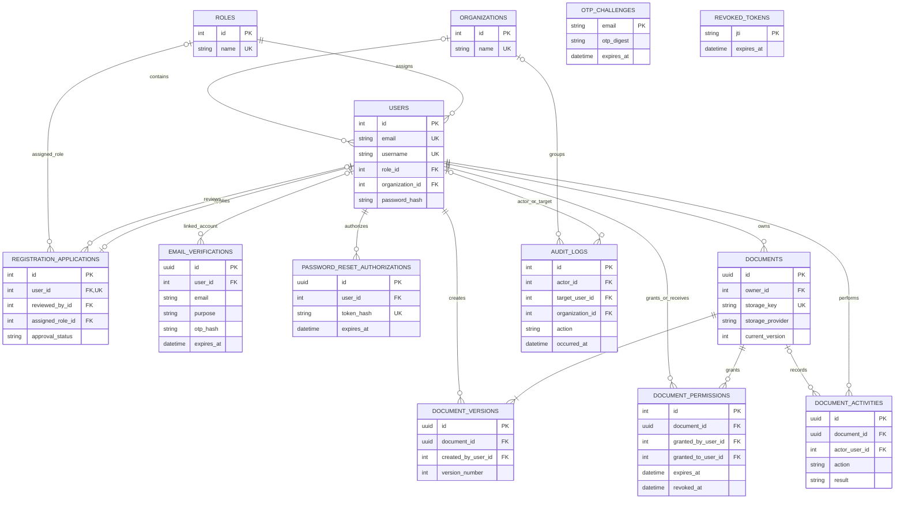

# Database architecture

VaultTrace uses PostgreSQL through SQLAlchemy 2 and Psycopg 3. Alembic migrations are the schema source of truth. File bytes are stored outside PostgreSQL; rows in `documents` and `document_versions` identify the private storage provider and object.

## Entity relationship diagram



`OTP_CHALLENGES.email` is the primary key and has no user foreign key. `EMAIL_VERIFICATIONS.user_id` is nullable for signup proofs; reset challenges link to the account. `AUDIT_LOGS.actor_id`, `target_user_id`, and `organization_id` are nullable in the latest migration. `DOCUMENT_ACTIVITIES.document_id` is nullable so a deleted document can remain represented in history.

Relationships are enforced with foreign keys and delete behavior where defined. Organization membership is optional; the application does not infer an organization from email domains. The database schema uses string values and checks for statuses/levels rather than PostgreSQL enum types.

## Table purpose

| Table | Purpose |
|---|---|
| `roles`, `users` | Account identity, Argon2 hash, role, activity/verification state, organization and token version. |
| `registration_applications` | Approval workflow, reviewer, chosen role and rejection reason. |
| `otp_challenges` | Earlier email OTP implementation with per-email throttling state. |
| `email_verifications` | Purpose-specific signup/reset OTP digest and lifecycle state. |
| `password_reset_authorizations` | Hashed, single-use reset authorization and expiry. |
| `revoked_tokens` | Revoked JWT IDs and expiry. |
| `organizations` | Administrator-managed tenant membership group. |
| `documents` | Document metadata and current object pointer. |
| `document_versions` | Immutable historical version metadata and object pointer. |
| `document_permissions` | Per-document recipient access, expiry, and revocation state. |
| `document_activities` | Document-level access and collaboration events. |
| `audit_logs` | Auth/admin/document business audit records and request context. |

## Migration history

The repository contains one linear chain; local head is `20261105_0010`.

| Revision | Change |
|---|---|
| `20261103_0001` | Creates roles, users, revoked tokens; seeds Administrator, Owner, Viewer. |
| `20261103_0002` | Adds registration fields/applications, legacy OTP and initial audit table; backfills existing user fields. |
| `20261103_0003` | Adds token version, purpose-specific email verification and reset authorization. |
| `20261103_0004` | Creates document metadata table. |
| `20261104_0005` | Adds storage provider labels; existing rows receive the migration default `supabase`. Verify legacy byte location before relying on this mapping. |
| `20261104_0006` | Adds user update timestamp. |
| `20261104_0007` | Adds database default for user update timestamp. |
| `20261104_0008` | Adds visibility, soft-delete and version fields; backfills one version-1 metadata row per document; creates permissions and activity tables. No bytes are copied. |
| `20261104_0009` | Creates organizations and nullable user membership; existing accounts remain unassigned. |
| `20261105_0010` | Extends audit records with optional actor/resource/org/outcome/request fields. |

Upgrade operations add or alter schema, seed roles, and perform the documented backfills; the upgrade files do not drop tables. Downgrades can drop tables/columns and therefore can discard application history. Back up production before any migration and test downgrade/recovery procedures on a disposable copy. Do not use `alembic stamp` as a substitute for schema verification.

## Development commands

Run from the repository root with the Python environment activated and `.env` configured:

```bash
alembic -c backend/alembic.ini current
alembic -c backend/alembic.ini heads
alembic -c backend/alembic.ini upgrade head
```

By default Alembic uses `DATABASE_URL`. Production mode is explicitly selected with `ALEMBIC_USE_PRODUCTION_DATABASE=true` and `PRODUCTION_DATABASE_URL`; keep that selection scoped to the migration process. The app's runtime engine uses `DATABASE_URL`.

## Data and operational boundaries

- PostgreSQL stores metadata and indexes, not document bytes.
- The configured local directory or Supabase bucket stores document content and version objects.
- Storage and database writes are separate systems; the service attempts cleanup if metadata persistence fails, but cleanup itself can fail. Monitor for orphaned objects and provide reconciliation tooling.
- Expired OTP/reset rows, revoked JWT rows, old versions, and soft-deleted content have no scheduled cleanup job in this repository.
- No backup schedule or restore automation is defined here. Verify database and object-storage backup/retention settings with the operators.
