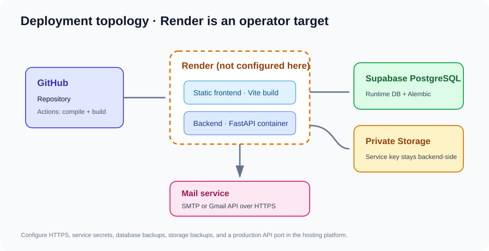
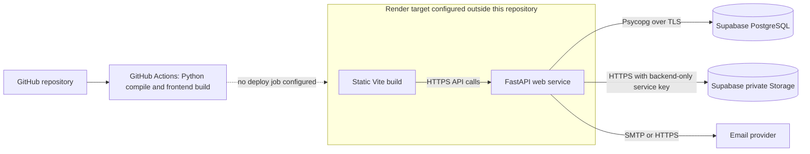

# Local and production deployment

This guide documents repository behavior and a cautious Render deployment shape. There is no `render.yaml` or other Render configuration in the repository, so production service settings described here are recommendations, not a statement about the current live deployment.





The diagram's Render and Supabase connections represent the recommended target architecture; this repository does not confirm live service configuration. GitHub Actions has no deploy job.

## Current repository deployment files

- `backend/Dockerfile` installs `requirements.txt`, copies the backend, and starts Uvicorn on `0.0.0.0:8000`.
- `frontend/Dockerfile` installs packages with `npm install` and starts Vite's development server on port 5173. Use this for development only, not production static hosting.
- `docker-compose.yml` starts Mailpit, backend, and frontend. It does **not** start PostgreSQL. The backend uses host networking and mounts `./private_storage`.
- `.github/workflows/ci.yml` runs Python compilation and frontend build checks on pushes and pull requests. It does not deploy or run pytest/Playwright.
- No Render service/blueprint file, database backup policy, or production environment values are tracked here.

## Local Docker Compose

1. Configure a local `.env` from `.env.example` without overwriting an existing `.env`.
2. Provision/reuse a PostgreSQL database and set `DATABASE_URL`.
3. Apply migrations from the repository root:

   ```bash
   alembic -c backend/alembic.ini upgrade head
   ```

4. Start local services:

   ```bash
   docker compose up --build
   ```

Compose exposes Vite at port 5173, the API at 8000, and Mailpit's web inbox at 8025. The Compose backend uses `network_mode: host`, a Linux-oriented choice that does not behave like normal Compose service networking on all Docker Desktop platforms. Configure host-reachable database and SMTP addresses accordingly.

Stop containers with `Ctrl-C` or `docker compose down`. The local storage volume persists under `./private_storage`; do not add this directory to a public static path or commit it.

## Render deployment shape

### Frontend Static Site (recommended target)

The React app is a client-side Vite application, so a static site is appropriate. Configure the Render Static Site with:

| Setting | Value |
|---|---|
| Root directory | `frontend` |
| Build command | `npm ci && npm run build` |
| Publish directory | `dist` |
| Build environment | `VITE_API_BASE_URL=https://<backend-host>/api/v1`; optional upload-limit hints only |
| Rewrite | `/*` → `/index.html` (Rewrite) for React Router deep links |

Only public, non-secret values belong in `VITE_*`: Vite embeds them in browser assets. Never set database, JWT, SMTP, Gmail OAuth, or Supabase service-role secrets on the frontend.

Render documents Vite static builds as `npm ci && npm run build` with `dist` output and recommends a rewrite to `index.html` for client-side routes ([Static Sites](https://render.com/docs/static-sites), [Redirects and Rewrites](https://render.com/docs/redirects-rewrites)).

### Backend Web Service

The existing backend Dockerfile assumes the repository root is the build context because it copies root `requirements.txt` and `backend/`. If selecting Docker deployment in Render, use repository root as the Docker context and `backend/Dockerfile` as the Dockerfile path. Render supports separate Dockerfile and context paths for monorepos ([Docker on Render](https://render.com/docs/docker)).

The current Docker command binds to `0.0.0.0:8000` and hardcodes port 8000. Render web services default to port 10000 and recommend binding to the `PORT` variable ([Web Services](https://render.com/docs/web-services)). Before deploying this image, either configure the service's `PORT` to `8000` to match the current command, or update the Docker command to honor the platform-provided `PORT` and rebuild. No such adjustment is made by this documentation task.

Configure the backend environment through the Render secret/environment settings, not in source or frontend build variables:

| Variable group | Purpose |
|---|---|
| `APP_ENV=production` | Enables production storage validation/default behavior. The code defaults to development if omitted. |
| `DATABASE_URL` | Runtime PostgreSQL connection using a Psycopg 3-compatible URL. |
| `JWT_SECRET_KEY`, `OTP_HASH_SECRET` | Independent random application secrets. |
| `FRONTEND_ORIGIN` | Exact deployed frontend origin used by CORS. |
| `STORAGE_PROVIDER=supabase`, `SUPABASE_URL`, `SUPABASE_SERVICE_ROLE_KEY`, optional bucket | Private Supabase object storage; service-role key is backend-only. |
| Email provider settings | `EMAIL_PROVIDER=gmail_api` plus Gmail OAuth fields, or correctly configured SMTP settings. Default `mailpit` is for local development. |
| `DOCUMENT_MAX_UPLOAD_BYTES`, `DOCUMENT_ALLOWED_EXTENSIONS` | Optional server-side upload policy overrides. |

Use the exact variable names and defaults in [`.env.example`](../.env.example). Do not copy a local database URL into Render. Confirm the database host/database name independently in the secret manager UI without placing the URL in logs or tickets.

Render terminates public HTTPS and forwards traffic to the service; validate that redirects, API CORS, static-site HTTPS, security headers, custom domains, and health checks match the actual service setup. The application's `/health` route only returns a static process status; it does not test PostgreSQL, email, or storage.

### Database migrations

The runtime API reads `DATABASE_URL`. Alembic uses that URL unless production mode is explicitly enabled with `ALEMBIC_USE_PRODUCTION_DATABASE=true` and `PRODUCTION_DATABASE_URL`.

Before production upgrade:

1. Confirm a recent database and object-storage backup and a tested restore process.
2. Inspect the local head and production current revision using a read-only connection.
3. Review migration order, backfills, and any assumptions about existing file locations.
4. Run migration commands from a controlled operator workstation or dedicated migration job with secrets available only to that process.

```bash
export ALEMBIC_USE_PRODUCTION_DATABASE=true
alembic -c backend/alembic.ini current
alembic -c backend/alembic.ini heads
# After change review and operational approval:
alembic -c backend/alembic.ini upgrade head
unset ALEMBIC_USE_PRODUCTION_DATABASE
```

The last command applies schema changes; it is not a read-only check. Never run it until the selected host and database are verified and a recovery plan exists. The migration history is in [Database](DATABASE.md).

### Administrator bootstrap

`backend/app/bootstrap_admin.py` reads the four `ADMIN_BOOTSTRAP_*` variables and uses the configured `DATABASE_URL`; it creates a first Administrator only if none exists. `backend/app/bootstrap_admin2.py` selects and validates `PRODUCTION_DATABASE_URL` before importing `SessionLocal`, then reads the `ADMIN2_*` variables and refuses local/non-Supabase hosts. Both use the application's Argon2 hash function and write an audit event. Do not put bootstrap passwords in command arguments; set them in a protected environment/secret store and remove them after the operation.

Run only one intentional bootstrap command after verifying its selected target and account variables:

```bash
PYTHONPATH=backend python -m app.bootstrap_admin
PYTHONPATH=backend python -m app.bootstrap_admin2
```

The second command is the Admin 2 operation. It is idempotent for the exact account it created and will not overwrite a conflicting account. Do not run either command as part of normal service startup.

## Observability and recovery

- Configure Render health checks at `/health` for process liveness, but add a separate readiness check before relying on it for database availability.
- Monitor application errors, email delivery failures, storage failures, database connection saturation, rejected logins, OTP volume, and denied document access.
- Test restoration of both PostgreSQL metadata and stored document objects. Restoring one without the other can produce missing documents.
- Set retention and incident response procedures for access tokens, OTP/reset rows, audit events, versions, and soft-deleted files.
