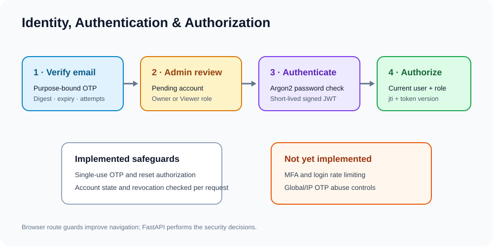
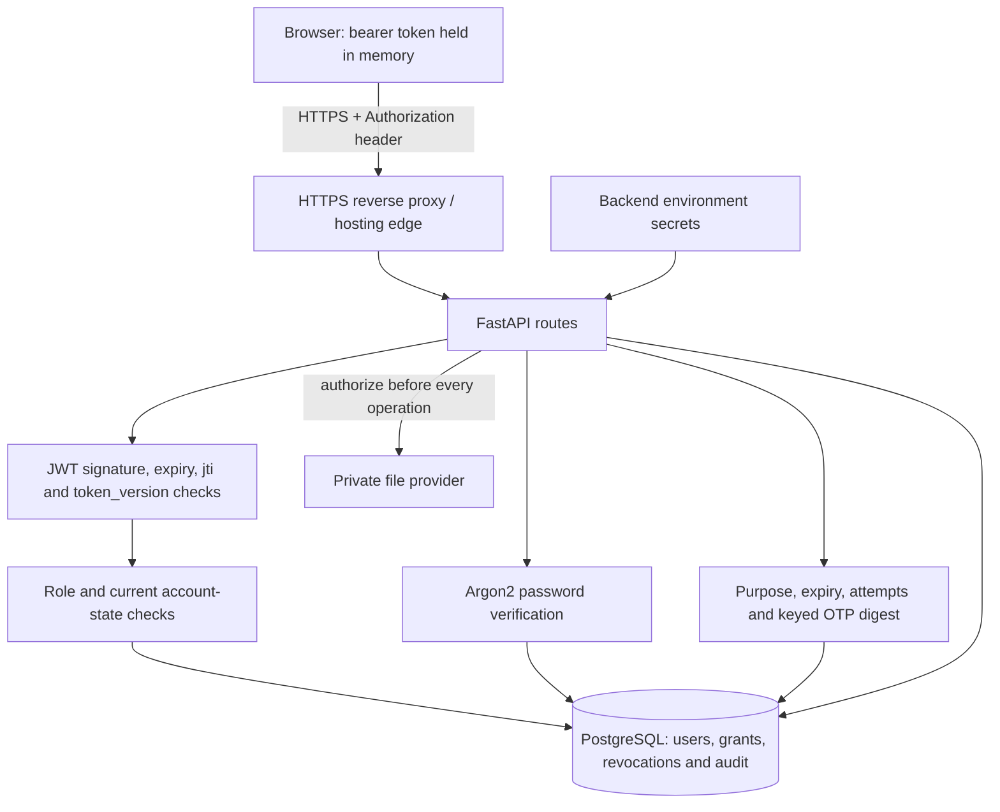

# Security architecture and operational guidance

This document separates controls implemented in the repository from recommended hardening. It is not a penetration-test result, compliance attestation, or proof that a deployed environment is secure.

## Security architecture

The API—not the React route guards—is the authorization boundary. The database and storage credentials are server-side. The edge/hosting platform must supply HTTPS and protect deployment secrets.

## Implemented controls

### Passwords and authentication

- Passwords are hashed and verified through `pwdlib`'s recommended Argon2 implementation in `backend/app/core/security.py`.
- Registration/reset schemas require 12–128 characters and confirm matching values. The bootstrap scripts also enforce a minimum length.
- Login checks password, `is_active`, `email_verified`, and `account_status` and returns a generic credential error.
- JWTs are signed using configured algorithm/key, include expiry, type, `jti`, subject, and token version. Default expiry is 15 minutes.
- Protected requests validate the signature and expiry, check `revoked_tokens`, load current account state, and compare token version.
- Logout revokes the current JWT ID. Password reset and admin status/role changes increment token version to invalidate sessions.
- The frontend stores the access token in React memory, not localStorage/sessionStorage. A reload signs the user out.

### OTP and password reset

- OTPs are generated with the standard cryptographic `secrets` module, have six digits, and are persisted as an HMAC digest using `OTP_HASH_SECRET` (with JWT-secret fallback if absent).
- Signup and password-reset purposes are separate. The configured expiry, attempt count, resend cooldown, and per-address hourly send limit are enforced.
- Verification is single-use and uses constant-time digest comparison. Password reset uses a random authorization token whose SHA-256 digest is stored, a configurable expiry, and one-time consumption.
- Forgot-password responses are generic to reduce account enumeration.

### Authorization and documents

- FastAPI dependencies load the current account and enforce role checks; admin routes apply an Administrator dependency at router level.
- Document operations check owner or current grant, account activity, organization boundary, visibility, expiry, permission level, and revocation. Unauthorized document IDs are generally concealed as 404.
- Admin document endpoints expose metadata and permission/audit views; they do not provide direct file-content access.
- Upload checks allowlisted extension, detected signature, supplied MIME, file size, empty content, filename sanitization, and checksum. Storage keys are UUID-derived rather than based on submitted paths.
- Local storage stays outside frontend static directories, uses restrictive POSIX permissions where supported, and rejects traversal/symlinks. Supabase storage checks that the bucket is private. Downloads are streamed through authenticated API routes with `no-store`/`nosniff` headers.
- CSV audit export prefixes formula-leading strings. React renders user content as text; no `dangerouslySetInnerHTML` usage was found.

### Audit, email, secrets and browser policy

- Login outcomes, password resets, administrator actions, document operations, and access denials are audited. Audit metadata filters keys resembling credentials/tokens/passwords and bounds values.
- SMTP/Gmail/Supabase sensitive values use `SecretStr` in some settings; errors in core application paths generally log exception classes and fixed diagnostics rather than secret-bearing exception text.
- CORS uses one configured origin, explicit methods/headers, and does not allow cookies. Auth is bearer-header based, so cookie CSRF is not the primary model.
- Gmail OAuth client and token files are Git-ignored; the Supabase service-role key must remain backend-only.

## Known gaps and risks

| Gap | Status in repository | Recommendation |
|---|---|---|
| Login throttling / lockout | Not present in login route/service. | Add distributed IP/account rate limits, alerting, and tests that preserve generic responses. |
| OTP abuse prevention | Per-email cooldown and hourly limit exist; no source-level IP/global limits. | Add edge and shared-store limits to prevent address rotation and multi-instance bypass. |
| MFA | Not implemented. | Add TOTP or WebAuthn, recovery codes, and stronger admin enrollment policy. |
| Malware/content inspection | No scanner/quarantine workflow. | Quarantine uploads, scan asynchronously, and allow download only after clean status. |
| Global security headers | Not configured in FastAPI source. Preview responses have a sandbox CSP. | Set CSP, HSTS, frame protection, Referrer-Policy, and Trusted Host policy at the trusted edge/app. |
| Secret settings types | Some secret settings are plain strings, including JWT/database/SMTP/bootstrap values. | Use secret types, secret-manager references, redaction tests, and rotate keys through an operational process. |
| Audit integrity | Application inserts records but database operators can update/delete them. | Export to independently permissioned immutable storage; alert on privileged/admin changes. |
| Retention | No cleanup jobs for expired OTP/reset records, revoked tokens, soft-deleted content, or old versions. | Set documented retention periods and audited purge/reconciliation jobs. |
| Tenant isolation | Organization and grant checks are in application code; Supabase uses a service-role credential. | Keep centralized checks, add cross-tenant tests, restrict service key access, and evaluate DB/storage defense in depth. |
| Upload resources | API reads file into memory (bounded to configured size); downloads return bytes from provider before response. | Add concurrency/request-size limits and streaming for larger files. |
| Production configuration | `APP_ENV` defaults to development; storage default then becomes local. | Fail startup unless production mode, HTTPS origin, persistent storage, and required secrets are explicitly configured. |
| Supply chain / CI | CI builds/compiles but does not run tests or vulnerability scans. Backend dependency ranges lack a lockfile. | Lock/pin resolution, run tests and dependency/SBOM/container scans, protect releases on required checks. |

No direct SQL injection, application-generated HTML injection, cookie-based CSRF, or user-controlled URL-fetch path was identified in the inspected code. This is a static review, not proof that such issues are absent in all deployment paths.

## Production hardening checklist

1. Require explicit production settings and validate storage, database, email, CORS, and JWT configuration before serving traffic.
2. Store secrets in the hosting secret manager; never expose them through `VITE_*`, logs, build arguments, screenshots, or support tickets.
3. Revoke and rotate any credential that may have been disclosed. OAuth refresh tokens and service-role credentials should have documented owner, scope, and rotation process.
4. Terminate TLS at a trusted edge and verify HTTPS redirect, HSTS, security headers, host validation, and CORS against the actual frontend origin.
5. Apply API rate limits and WAF/request-size limits; add login, OTP, upload, and admin-abuse alerts.
6. Use least-privilege PostgreSQL roles; separate runtime access from migration/administrative access where practical.
7. Keep Supabase buckets private and validate that the configured project URL and bucket are the expected ones. Do not put the service-role key in the browser.
8. Back up PostgreSQL and object storage, test restore, and maintain an incident recovery plan.
9. Scan dependencies and images, run automated authorization tests, and periodically perform an independent security review.
